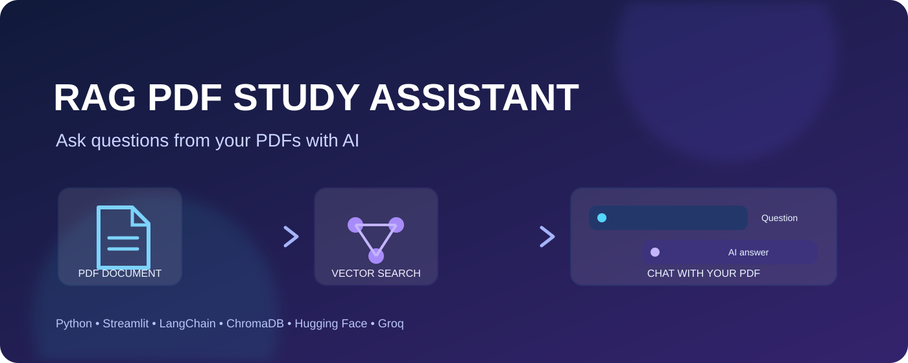

# 📚 RAG PDF Study Assistant



An AI-powered PDF question-answering chatbot built using **Retrieval-Augmented Generation (RAG)**. Upload your own PDF, ask questions, and get AI-generated answers based on the document content.

## 🚀 Features

- Upload your own PDF documents.
- Extract text from PDF files.
- Split documents into smaller text chunks.
- Generate embeddings using Hugging Face.
- Store document embeddings in ChromaDB.
- Retrieve relevant information using MMR search.
- Generate answers using Groq LLM.
- Interactive chatbot interface using Streamlit.
- Answers grounded in uploaded PDF content.

## 🛠️ Technologies Used

- Python
- LangChain
- Streamlit
- ChromaDB
- Hugging Face Sentence Transformers
- Groq API
- PyPDF

## 🧠 RAG Architecture

1. Upload PDF document.
2. Extract text from the PDF.
3. Split text into smaller chunks.
4. Generate embeddings using Hugging Face.
5. Store embeddings in ChromaDB.
6. User enters a question.
7. Retrieve relevant chunks using MMR.
8. Send context and question to Groq LLM.
9. Generate an answer using the retrieved information.

## 📂 Project Structure

```text
RAG_project/
│
├── Document loder/
├── vectorstore/
├── app.py
├── DB.py
├── main.py
├── requirements.txt
├── .env
├── .gitignore
└── README.md
```

## ⚙️ Installation and Setup

### 1. Clone the repository

```bash
git clone https://github.com/pagaleatharva/RAG-PDF-Study-Assistant.git
```

### 2. Open project folder

```bash
cd RAG-PDF-Study-Assistant
```

### 3. Create virtual environment

```bash
python3 -m venv .venv
```

### 4. Activate virtual environment

macOS / Linux:

```bash
source .venv/bin/activate
```

Windows:

```bash
.venv\Scripts\activate
```

### 5. Install dependencies

```bash
python -m pip install -r requirements.txt
```

### 6. Configure Groq API Key

Create a `.env` file in the project directory.

```env
GROQ_API_KEY=your_groq_api_key
```

Get your API key from:
https://console.groq.com/

### 7. Run the application

```bash
streamlit run app.py
```

Open the local URL displayed in your terminal:

```text
http://localhost:8501
```

## 💬 How to Use

1. Open the application.
2. Upload your PDF document.
3. Click **Process PDF**.
4. Wait for document processing.
5. Enter your question in the chat box.
6. Get an AI-generated answer based on your PDF.

## 📸 Screenshots

Add your application screenshots inside the `images` folder.

Example:


## 🔮 Future Improvements

- Support multiple PDF uploads.
- Add chat history.
- Display source page numbers.
- Support DOCX and TXT files.
- Improve document retrieval.
- Deploy the application online.

## 👨‍💻 Author

**Atharva Pagale**

- GitHub: https://github.com/pagaleatharva
- LinkedIn: https://www.linkedin.com/in/atharva-pagale-224786296/

---

⭐ If you like this project, consider giving it a star!
